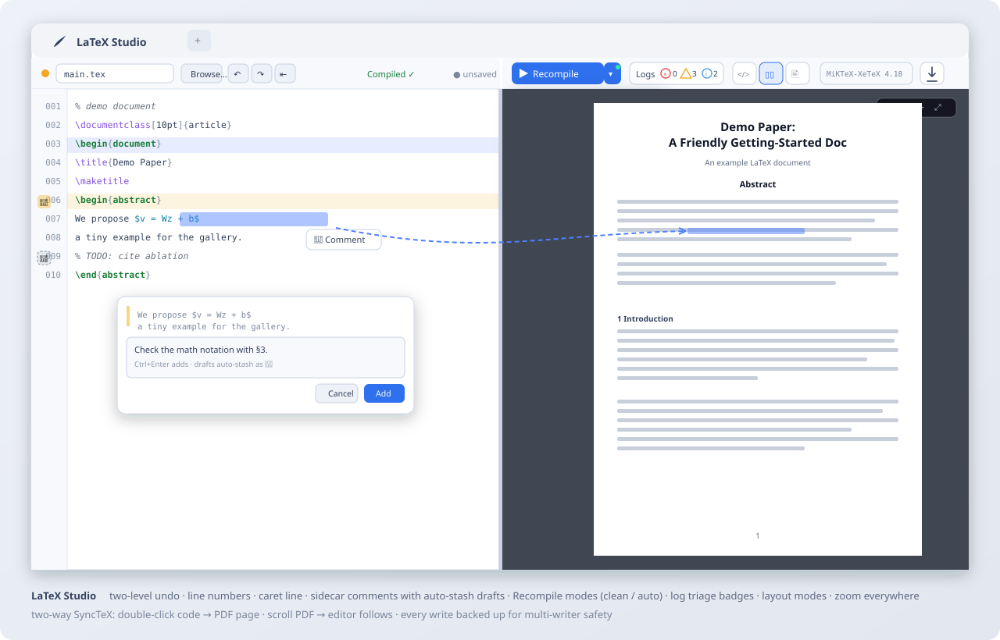

# dsh-latex-studio

> An Overleaf-style LaTeX workbench inside the DeepSeek Harness right sidebar: edit `.tex` with syntax highlighting and line numbers, compile with one click, read the PDF right next to the source — with two-way SyncTeX navigation and inline comments. The conversation column is never touched.



## Editor

| | |
|---|---|
| 🖋 **Syntax highlighting** | commands, environments, comments, inline math, braces and separators — theme-aware |
| 🔢 **Line-number gutter** | zero-padded numbers synced with scroll; in soft-wrap mode the number aligns with the logical line and continuation rows stay blank |
| 🎯 **Caret-line band** | the line the cursor sits on is highlighted; follows scrolling exactly, also under soft wrap |
| ↩ **Two-level undo** | ↶/↷ step through grouped edits (keystrokes in a burst coalesce into one step), ⇤ jumps straight back to the last saved state (Ctrl+Z / Ctrl+Y / Ctrl+Alt+Z) |
| 💾 **Save model** | Ctrl+S saves; Compile always saves first; unsaved state is marked with a ● before the file name |
| 🔍 **Zoom** | Ctrl+mouse wheel or Ctrl +`+`/`-`/`0`, 8–28 px, in both the editor and the PDF |
| ✍ **Soft wrap** | Alt+Z |
| 💬 **Comments** | select text → Comment button (anchored tight to the selection end) → a note saved to a hidden sidecar file next to the .tex (the LaTeX source is never modified). Commented lines get a yellow band + gutter chip; unfinished drafts are stashed as pending chips and can be resumed anytime |

## Compile

| | |
|---|---|
| ⚡ **Engines** | `pdflatex` / `xelatex` / `lualatex`, auto-discovered from PATH (MiKTeX or TeX Live); the toolbar shows the selected engine's real version |
| 📋 **Mode menu** | ▾ next to Compile: **Recompile** (single pass) / **Clean and recompile** (removes aux outputs first, keeps .bbl and the PDF) / **Auto compile** (compile on save and on adopted external changes) |
| 🧭 **Main-document discovery** | open a section file such as `sec/method.tex` and compile straight away: the root document (prefers `main.tex`, requires `\documentclass`) is found and compiled; if the root comments your subfile out (e.g. a template's commented-out `\input{...}` for supplementary material), the status line says so |
| 🧮 **Log triage** | the Logs button tallies errors / warnings / notices (red ⚠ and info ⓘ counts) and toggles the PDF pane into a full-height log view with severity-colored lines |

## PDF pane

- Live preview rendered by the bundled **pdf.js** (lazy per-page canvases, bounded memory)
- **Selectable text** (own text layer, pixel-aligned to the canvas)
- **Two-way SyncTeX**: double-click in the source → the PDF scrolls to that page; scrolling or clicking a PDF page → the editor follows. Resolved through your distribution's own `synctex` tool, per-file correct in multi-document projects
- **Zoom**: Ctrl+wheel or the floating −/%/+ bar, 40–300%
- **Layout modes**: `</>` source only · `▯▯` split · `🖹` PDF only (the toggle mirrors into the source bar in code-only mode, so you can always switch back)

## Multi-writer safety (agent + device co-editing)

- A 5-second watcher **adopts external file changes automatically** while you have no unsaved edits — a stale buffer can never overwrite an agent's work
- With unsaved edits, saving performs an **automatic three-way line merge**; the double-paste pollution shape (same block added on both sides) is **deduplicated to one copy**; only genuinely overlapping edits abort
- Every write snapshots the previous disk copy into `.dsh-latex-studio-backups/` (5 newest per file)

## Install

From npm:

```
@zhaulee/dsh-latex-studio
```

Or install from this repository (source or the GitHub Release tarball) via **Plugin Manager → Add plugin** in DSH Desktop.

## Requirements

- A TeX distribution on the machine serving DSH (TeX Live / MiKTeX), with at least one of `pdflatex`, `xelatex`, `lualatex` on `PATH`.
- The document lives inside (or is readable from) the session's workspace.

## Limitations

- Single-pass compile by default: `biblatex`/`biber`, `makeindex` and multi-pass cross-references need a second compile (the second pass resolves the `.aux` state written by the first).
- Engines run under the DSH Host user's environment; no container isolation.
- Reverse sync is page-granular (jumps to the page's first source line), not paragraph-anchored.
- Comments anchor to logical lines (the quoted excerpt is stored as context); comment drafts live in memory, saved comments persist in the sidecar file.

## License

MIT — see [LICENSE](LICENSE).
