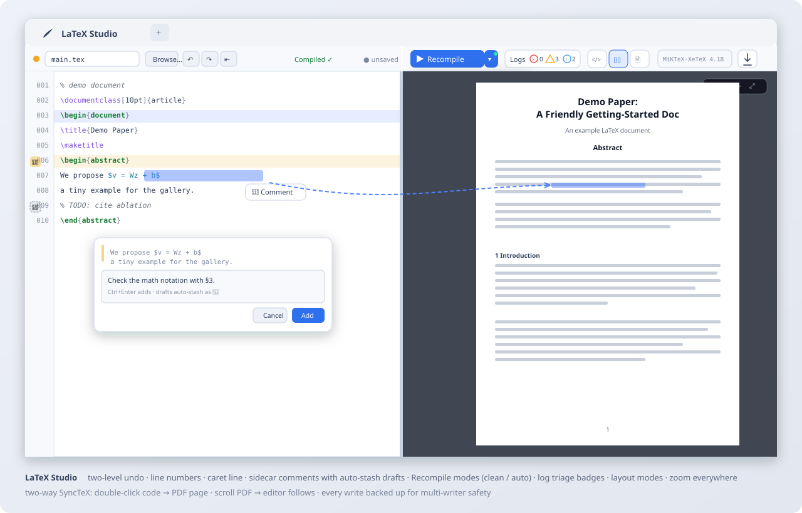

# LaTeX Studio

An Overleaf-style LaTeX edit / compile / preview workbench inside the DSH right
Sidebar. The conversation column is never modified.

## The tab

- **Two panes with a draggable splitter**, plus layout modes: source-only `</>`, split `▯▯`, PDF-only `🖹` (the toggle mirrors into the source bar in code-only mode).
- **Source editor**: theme-aware syntax highlighting, line-number gutter (wrap-aware), caret-line band, Alt+Z soft wrap, Ctrl+wheel zoom (8–28 px).
- **PDF pane**: bundled pdf.js rendering (lazy per page, selectable text), zoom bar and Ctrl+wheel (40–300%), the Logs button toggles a severity-colored full-height log view.

## Compile

- Toolbar: main `.tex` path + Browse… picker; the Compile button (▶) with a **mode menu** next to it: **Recompile**, **Clean and recompile** (drops aux outputs first, keeps `.bbl` and the PDF), **Auto compile** (compiles on save and on adopted external changes). The selected engine's real version shows in the bar.
- **Auto-discovery of the root document**: compile straight from a section file; if the root comments your subfile out (e.g. a template's commented-out `\input{...}` for supplementary material), the status line says so.
- **Log triage**: the Logs button tallies errors (`!` lines), warnings and over/underfull notices with red/amber/blue badges.

## Editing model

- **Save**: Ctrl+S; Compile always saves first; a ● before the file name marks unsaved state.
- **Two-level undo**: ↶/↷ (Ctrl+Z / Ctrl+Y) step through grouped edits (typing bursts coalesce); ⇤ (Ctrl+Alt+Z) jumps straight back to the last saved state.
- **Comments**: select text → the Comment button sits tight at the selection's bottom-right corner → notes are stored in a hidden sidecar file (`.<base>.dshstudio.comments.json`), never in the .tex. Commented lines get a yellow band and a gutter 💬 chip (click to view/delete). Unfinished drafts auto-stash as 📝 chips when you move to another selection and can be resumed anytime. The whole comment UI scales with the editor font size.

## Sync

- **Two-way SyncTeX**: double-click in the source → the PDF smooth-scrolls to that page; scrolling or clicking a PDF page → the editor follows (page-granular). Resolved through your distribution's own `synctex` tool, correct per file in multi-document projects.

## Multi-writer safety (agent + device co-editing)

- While the tab is open, a 5 s watcher **adopts external file changes
  automatically** when you have no unsaved edits. With unsaved edits, saving
  performs an **automatic three-way line merge** — the same block added on
  both sides (the "double file" pollution shape) is deduplicated; only
  genuinely overlapping edits of different content abort the write (a ↻
  button adopts the disk version; a second Save within 30 s overwrites
  intentionally).
- Every write snapshots the previous disk copy into
  `.dsh-latex-studio-backups/` (5 newest per file) before touching the file.

## Requirements

- A TeX distribution on the machine serving DSH (TeX Live / MiKTeX), with at
  least one of `pdflatex`, `xelatex`, `lualatex` on `PATH`.
- The document lives inside (or is readable from) the session's workspace.

## Limitations

- Single-pass compile by default: `biblatex`/`biber`, `makeindex` and
  multi-pass cross-references need a second Compile click (the second pass
  resolves the `.aux` state written by the first).
- Engines run under the DSH Host user's environment; no container isolation.
- Reverse sync is page-granular (jumps to the page's first source line), not
  paragraph-anchored.
- Comments anchor to logical lines (the quoted excerpt is stored as context);
  saved comments persist in the sidecar file, drafts live in memory.
